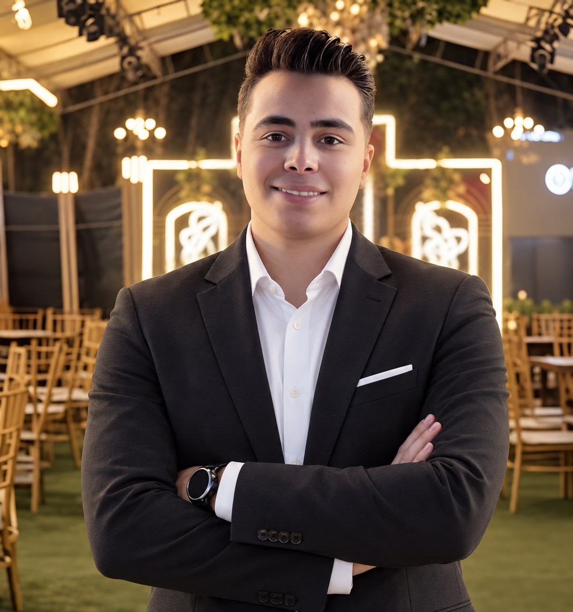
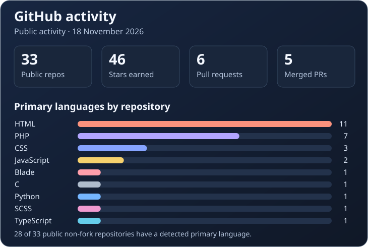

<!-- Design patterns adapted from templates 47 (contact badges), 16 (tech badges), and 6 (statistics and disclosure). -->

  
  <h1>Youssef Elfishawy</h1>
  
<strong>Full-Stack Developer · Laravel &amp; React</strong>

  

    
    
    
  

  

    <a href="#selected-work">Selected work</a> ·
    <a href="#tech-stack">Tech stack</a> ·
    <a href="#github-activity">GitHub activity</a>
  

## What I build

I build multi-tenant SaaS products, marketplaces, and API-driven platforms. My work spans Laravel APIs and payment integrations, React and Inertia interfaces, and Filament admin panels. I focus on database performance and the workflows teams rely on every day.

## Selected work

| Project | Role | Scope |
| --- | --- | --- |
| [Alam LMS & TMS](https://yousef-elfishawi.thotix.net/projects/alam-lms-tms) | Senior Backend Developer | Multi-tenant platform for learning, training, and diploma programmes. |
| [Tamam](https://yousef-elfishawi.thotix.net/projects/tamam) | Backend Developer | Technician bookings, custom quotes, real-time chat, and digital wallets. |
| [Nesf Elsaee](https://yousef-elfishawi.thotix.net/projects/nesf-elsaee) | Backend Developer | Real estate marketplace with digital auctions and Nafath identity verification. |
| [JEC ERP](https://yousef-elfishawi.thotix.net/projects/jec-erp) | Team Lead Backend Developer | Multi-tenant ERP that tracks projects, staffing, and finance from quote to invoice. |

[Browse the full portfolio →](https://yousef-elfishawi.thotix.net/projects)

<strong>Browse public code</strong>

- [Laravel Tenancy](https://github.com/youssefsafwat234/Laravel-tenancy)
- [Custom Filament Page](https://github.com/youssefsafwat234/custom-filament-page)
- [Nesf Elsaee on GitHub](https://github.com/youssefsafwat234/Nesf_V2)

## Tech stack

| Area | Tools |
| --- | --- |
| **Backend & APIs** |    |
| **Frontend & admin** |    |
| **Data & infrastructure** |     |

## GitHub activity

  

[Live contribution calendar](https://github.com/youssefsafwat234#year-list-container) · [Public repositories](https://github.com/youssefsafwat234?tab=repositories&type=public) · [Public pull requests](https://github.com/pulls?q=is%3Apr+is%3Apublic+author%3Ayoussefsafwat234)

Layout adapted from <a href="https://github.com/Ashfaq-Riyaldeen/199-best-github-profile-readme-templates/blob/main/templates/readme-template%20%2847%29.md">template 47</a>, <a href="https://github.com/Ashfaq-Riyaldeen/199-best-github-profile-readme-templates/blob/main/templates/readme-template%20%2816%29.md">template 16</a>, and <a href="https://github.com/Ashfaq-Riyaldeen/199-best-github-profile-readme-templates/blob/main/templates/readme-template%20%286%29.md">template 6</a>.
